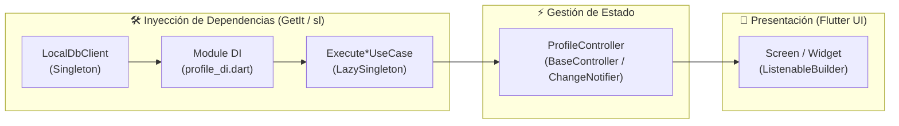

# 📦 Gestión de Estado e Inyección de Dependencias con GetIt (`sl`)

Este documento detalla la arquitectura, el propósito y los estándares de uso de **GetIt** en Tracknner, aclarando su rol como **Service Locator / Inyector de Dependencias (DI)** y su articulación con la **Gestión de Estado Reactiva** basada en `BaseController<T>` y `ChangeNotifier`.

---

## 🎯 1. Clarificación Conceptual: Service Locator vs Gestor de Estado

> [!NOTE]
> **GetIt no es un gestor de estado.**  
> GetIt es un **Service Locator (IoC / DI Container)** de alto rendimiento para Dart/Flutter. Su función es desacoplar la creación, ciclo de vida y resolución de dependencias entre capas.  
> La **Gestión de Estado** en Tracknner la realizan los **Controladores** (`BaseController<T>`, que extiende `ChangeNotifier`), los cuales son provistos o instanciados a través de GetIt y escuchados en la UI mediante `ListenableBuilder`.



---

## 🏗️ 2. Estructura de Inyección en el Proyecto

### 2.1. Contenedor Global (`sl`)
La instancia única del service locator se define centralizada en `lib/core/di/injection_container.dart`:

```dart
import 'package:get_it/get_it.dart';

final GetIt sl = GetIt.instance;
```

> **Convención:** Usamos `sl` (*Service Locator*) como identificador estándar en todo el proyecto.

---

## ⚙️ 3. Modos de Registro en GetIt

Tracknner utiliza diferentes estrategias de registro según el ciclo de vida y la naturaleza del componente:

| Método | Ciclo de Vida | ¿Cuándo se usa? | Ejemplo en Tracknner |
|---|---|---|---|
| `registerSingleton<T>()` | Inmediato (Eager) | Servicios de infraestructura pesados o asíncronos que deben estar listos al iniciar la app. | `DatabaseConnection` como `LocalDbClient` en `database_di.dart`. |
| `registerLazySingleton<T>()` | Bajo Demanda (Lazy) | Servicios y casos de uso sin estado efímero que se inicializan la primera vez que se solicitan. | `ExecuteCreateUserUseCase` en `profile_di.dart`. |
| `registerFactory<T>()` | Nueva Instancia | Controladores de pantallas o entidades con estado efímero que deben crearse y destruirse por vista. | Controladores de formularios o páginas dinámicas. |

---

## 🔍 4. Casos de Uso Reales en el Repositorio

### 4.1. Infraestructura Global Asíncrona: `database_di.dart`
En `lib/core/infrastructure/database/di/database_di.dart`, la conexión a SQLite se inicializa antes del arranque de la app (`main.dart`) y se registra tipada contra su contrato abstracto:

```dart
// lib/core/infrastructure/database/di/database_di.dart
Future<void> initDatabaseDi() async {
  final databaseConnection = DatabaseConnection(
    models: [
      UserModel(),
      PetModel(),
      DailyMissionModel(),
      RunningSessionModel(),
    ],
  );

  await databaseConnection.initForDesktop();
  await databaseConnection.connect();

  // ✅ Se registra contra la abstracción/interfaz LocalDbClient
  sl.registerSingleton<LocalDbClient>(databaseConnection);
}
```

> [!TIP]
> **Programar hacia interfaces:** Siempre registra implementaciones concretas bajo el tipo de su abstracción (`sl.registerSingleton<LocalDbClient>(...)`). Esto permite cambiar SQLite por Drift o MockDatasources en tests unitarios sin modificar el resto de la app.

---

### 4.2. Inyección Modular y Registro de Acciones: `profile_di.dart`
En la arquitectura limpia de Tracknner, cada submódulo encapsula su cableado de dependencias (`datasources`, `repositories`, `validators`, `use cases`).

En `lib/modules/profile/di/profile_di.dart`, se consumen dependencias de `sl` y se exponen únicamente las **funciones ejecutoras (`typedef`)** de los casos de uso:

```dart
// lib/modules/profile/di/profile_di.dart
void initProfileDi() {
  //* 1. Obtención de infraestructura compartida
  late final dbClient = sl.get<LocalDbClient>();

  //* 2. Mappers, Validadores y Datasources
  late final createUserValidateSchema = CreateUserValidateSchema();
  late final userExistValidateShcema = LookingUserValidateSchema();
  late final userValidator = ValidatorAdapter<CreateUserDto>(createUserValidateSchema);
  late final userExistValidator = ValidatorAdapter<LookingUserDto>(userExistValidateShcema);
  late final userMapper = UserMapperImpl();

  late final queryUserDatasource = QueryUserLocalDatasource(
    dbClient: dbClient,
    userMapper: userMapper,
  );
  late final mutationDatasource = MutationUserLocalDatasource(
    dbClient: dbClient,
    mapperUser: userMapper,
  );

  //* 3. Repositorios
  late final queryUserRepository = QueryUserRepositoryImpl(queryDatasource: queryUserDatasource);
  late final mutationRepository = MutationUserRepositoryImpl(mutationDatasource: mutationDatasource);

  //* 4. Casos de Uso
  late final getUserAlreadyHaveAnAccount = GetUserAlreadyHaveAnAccountUseCase(
    queryUser: queryUserRepository,
  );
  late final createUser = CreateUserUseCase(
    mutationUserRepository: mutationRepository,
    queryUserRepository: queryUserRepository,
    userValidator: userValidator,
    userExistValidator: userExistValidator,
  );

  //* 5. Registro de Acciones Ejecutables (Typedefs) en GetIt
  sl.registerLazySingleton<ExecuteGetUserAlreadyHaveAnAccountUseCase>(
    () => getUserAlreadyHaveAnAccount.execute,
  );
  sl.registerLazySingleton<ExecuteCreateUserUseCase>(
    () => createUser.execute,
  );
}
```

#### ¿Por qué registrar `typedef` ejecutables en vez de toda la clase UseCase?
1. **Desacoplamiento Absoluto:** La capa de presentación/controladores no necesita conocer la clase concreta del caso de uso ni sus dependencias internas.
2. **Principio de Segregación de Interfaces (ISP):** Solo se inyecta la firma exacta de la función necesaria (`Future<void> Function(Unknown rawData)`).
3. **Facilidad de Mocking y Testing:** En pruebas unitarias del controlador, basta con pasar una función anónima o stub sin crear mocks complejos de clases.

---

## 🎮 5. Conexión con la Gestión de Estado (`BaseController<T>`)

### 5.1. El Controlador Base
En `lib/core/presentation/controllers/base_controller.dart`, `BaseController<T>` estandariza el manejo de estados asíncronos (`isLoading`, `errorMessage`, `data`) sobre la primitiva `ChangeNotifier` de Flutter:

```dart
// lib/core/presentation/controllers/base_controller.dart
abstract class BaseController<T> extends ChangeNotifier {
  bool _isLoading = false;
  String? _errorMessage;
  T? _data;

  bool get isLoading => _isLoading;
  String? get errorMessage => _errorMessage;
  T? get data => _data;

  @protected
  void setLoading({required bool isLoading}) {
    _isLoading = isLoading;
    notifyListeners();
  }

  @protected
  void setError(String message) {
    _errorMessage = message;
    _isLoading = false;
    notifyListeners();
  }

  @protected
  void setData(T data) {
    _data = data;
    _errorMessage = null;
    _isLoading = false;
    notifyListeners();
  }
}
```

### 5.2. Controlador del Módulo Recibiendo Acciones de GetIt
Los controladores específicos reciben sus dependencias por constructor. Pueden ser resueltos por `sl` o instanciados directamente con `sl.get()`:

```dart
// lib/modules/profile/presentation/controllers/profile_controller.dart
class ProfileController extends BaseController<User> {
  final ExecuteGetUserAlreadyHaveAnAccountUseCase getUserAction;
  final ExecuteCreateUserUseCase createUserAction;

  ProfileController({
    required this.getUserAction,
    required this.createUserAction,
  });

  Future<void> checkExistingAccount() async {
    setLoading(isLoading: true);
    try {
      final user = await getUserAction(const NoParams());
      if (user != null) {
        setData(user);
      } else {
        setLoading(isLoading: false);
      }
    } catch (e) {
      setError(e.toString());
    }
  }
}
```

---

## 📱 6. Consumo en la Capa de Presentación (UI)

Para mantener alto rendimiento y respetar las reglas de reconstrucción de Flutter:

### 6.1. Creación y Ciclo de Vida en un `StatefulWidget`

```dart
class ProfileScreen extends StatefulWidget {
  const ProfileScreen({super.key});

  @override
  State<ProfileScreen> createState() => _ProfileScreenState();
}

class _ProfileScreenState extends State<ProfileScreen> {
  // ✅ Instanciación fuera del build() resolviendo dependencias con GetIt
  late final ProfileController _controller = ProfileController(
    getUserAction: sl.get<ExecuteGetUserAlreadyHaveAnAccountUseCase>(),
    createUserAction: sl.get<ExecuteCreateUserUseCase>(),
  );

  @override
  void initState() {
    super.initState();
    _controller.checkExistingAccount();
  }

  @override
  void dispose() {
    // ⚠️ Obligatorio liberar controladores para evitar memory leaks
    _controller.dispose();
    super.dispose();
  }

  @override
  Widget build(BuildContext context) {
    return Scaffold(
      appBar: AppBar(title: const Text('Mi Perfil')),
      body: ListenableBuilder(
        listenable: _controller,
        builder: (context, _) {
          if (_controller.isLoading) {
            return const Center(child: CircularProgressIndicator());
          }

          if (_controller.errorMessage != null) {
            return Center(child: Text('Error: ${_controller.errorMessage}'));
          }

          final user = _controller.data;
          if (user == null) {
            return const Center(child: Text('Sin perfil registrado'));
          }

          return Center(child: Text('Hola, ${user.name}'));
        },
      ),
    );
  }
}
```

---

## 🛑 7. Reglas Obligatorias y Buenas Prácticas

> [!IMPORTANT]
> 1. **PROHIBIDO llamar a `sl.get()` dentro del método `build()`:**
>    - `sl.get()` nunca debe ejecutarse durante el ciclo de redibujado de la UI. Debe resolverse en atributos del `State`, en `initState()` o a nivel de configuración de rutas/constructores.
> 2. **Siempre registrar bajo contratos abstractos:**
>    - Usar `sl.registerSingleton<LocalDbClient>(...)`, nunca contra la clase concreta directamente.
> 3. **Encapsulamiento Modular:**
>    - Los archivos `*_di.dart` solo deben registrar y exponer elementos públicos o acciones ejecutables (`typedef`). Los repositorios y datasources internos deben permanecer privados dentro de su función de inicialización.
> 4. **Liberación de Memoria (`dispose`):**
>    - Si un controlador es registrado como `Factory` o instanciado manualmente en un `StatefulWidget`, debe invocarse obligatoriamente `controller.dispose()` en el método `dispose()` de la pantalla.

